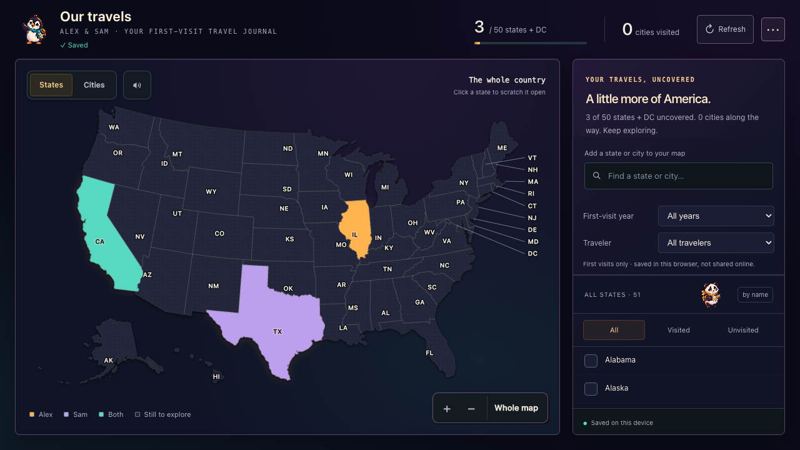

# Travel Scratch Map

A pixel-art US travel journal for two travelers. Scratch off the states and cities you visit for the first time, attach a memory and a photo, and explore your map by year or by traveler.

**[▶ Try it in your browser](https://sarvin-eshaghi.pages.dev/side-projects/travel-scratch-map/)** — no account needed. Your map is saved only in your own browser.



*Screenshot uses synthetic sample data.*

## Features

- **Scratch-off US map** of all 50 states and DC, with city search, zoom and pan, scratch effects and optional quiet sound.
- **Two travelers, three colours:** places visited by Alex, by Sam, or by both.
- **Memories:** a month and year, a short note and one compressed photo for each state or city.
- **Filters** by first-visit year and by traveler, with memory previews.
- **Your data stays yours:** saved in this browser's storage only; no login, no server, no analytics.
- **Backups:** export and import a JSON backup, export the map as an image, undo, and clear the map with confirmation.
- **Pixel-art companions:** a penguin and a panda travel with you.
- Works on desktop and phone.

Tracks **first visits only**: each place is scratched once, with the date you first went.

## Run it locally

You need [Node.js](https://nodejs.org/) 22 or newer. There are no npm dependencies to install.

```sh
npm run dev      # start a local server and print its URL
npm test         # run the checks
npm run build    # build the static site into dist/
```

`dist/` is plain static files with relative paths, so any static host can serve it, at the site root or in a subfolder.

## Data and privacy

Everything is saved to **this browser's localStorage**. Each visitor starts with an empty map, and nothing is sent anywhere. Opening the map in another browser or device starts a new, empty map, so export a JSON backup before clearing browser data or switching devices. Importing a backup replaces the current map. Photos count toward the browser's storage limit; if a save fails, the app warns you and keeps your data available to export.

Alex and Sam are neutral example names.

## Project structure

- `public/index.html`: the interface and map interactions.
- `public/cloud.js`: the browser storage adapter.
- `public/map-data.js`: state and city geometry and lookup data.
- `public/penguin-traveler.png`, `public/panda.png`: the companion characters.
- `scripts/`: the local server and build script. `tests/`: storage and path checks.

To rename the travelers, change the `Alex` and `Sam` keys and their lowercase CSS identifiers together, and convert any existing backups. Adding display labels while keeping the storage keys stable is the safer route.

## Licence and credits

**No open-source licence is granted yet.** You're welcome to read the code and use the live demo, but please don't reuse or redistribute it. The source of the state and city data in `public/map-data.js` is still being confirmed; a licence will be added once it is.

The penguin and panda were generated with an AI image tool (ImageGen) for this project.

Made by [Sarvin Eshaghi](https://sarvin-eshaghi.pages.dev/).
